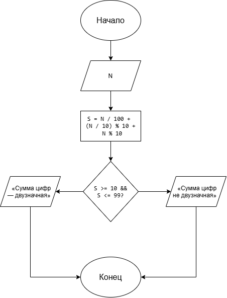

# Лабораторная работа 6

## Условие задачи

Дано целое число `N` (`N < 1000`). Написать программу, которая проверяет, является ли сумма цифр этого числа двузначным числом.

## 1. Алгоритм и блок-схема

### Алгоритм

1. **Начало**

2. Ввести целое число `N`.

3. Выделить сотни, десятки и единицы числа с помощью целочисленного деления и остатка от деления.

4. Вычислить сумму цифр числа:

   `S = N / 100 + (N / 10) % 10 + N % 10`

   Здесь используются целочисленные операции, поэтому для чисел меньше 100 первая цифра автоматически будет равна нулю.

5. Проверить, является ли сумма цифр двузначным числом. Для этого проверить условие:

   `S >= 10 && S <= 99`

6. Если условие выполняется, вывести сообщение, что сумма цифр является двузначным числом.

7. Если условие не выполняется, вывести сообщение, что сумма цифр не является двузначным числом.

8. **Конец**

### Блок-схема



## 2. Реализация программы

```c
#include <stdio.h>
#include <locale.h>

int main()
{
    setlocale(LC_ALL, "RUS");
    int N;
    int S;

    printf("Введите целое число N (N < 1000): ");
    scanf("%d", &N);

    S = N / 100 + (N / 10) % 10 + N % 10;

    printf("Сумма цифр числа: %d\n", S);

    if (S >= 10 && S <= 99)
    {
        printf("Сумма цифр является двузначным числом.\n");
    }
    else
    {
        printf("Сумма цифр не является двузначным числом.\n");
    }

    return 0;
}
```

## 3. Результаты работы программы

Для проверки программы рассмотрим несколько примеров.

**Пример 1.** Введём число `N = 567`.

После запуска программы получаем:

```text
Введите целое число N (N < 1000): 567
Сумма цифр числа: 18
Сумма цифр является двузначным числом.
```

### Расчёт

`S = 5 + 6 + 7 = 18`

Число `18` является двузначным, поэтому программа выводит соответствующее сообщение.

**Пример 2.** Введём число `N = 123`.

После запуска программы получаем:

```text
Введите целое число N (N < 1000): 123
Сумма цифр числа: 6
Сумма цифр не является двузначным числом.
```

### Расчёт

`S = 1 + 2 + 3 = 6`

Число `6` является однозначным, поэтому программа выводит сообщение, что сумма цифр не является двузначным числом.

Таким образом, программа вычисляет сумму цифр заданного числа и проверяет, является ли полученная сумма двузначным числом.

## 4. Информация о разработчике

**Фамилия:** Гусакова

**Имя:** Ксения

**Группа:** БИЦТ-261
